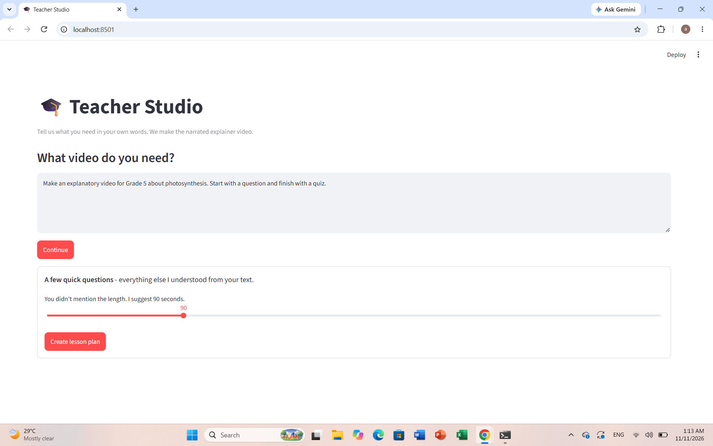
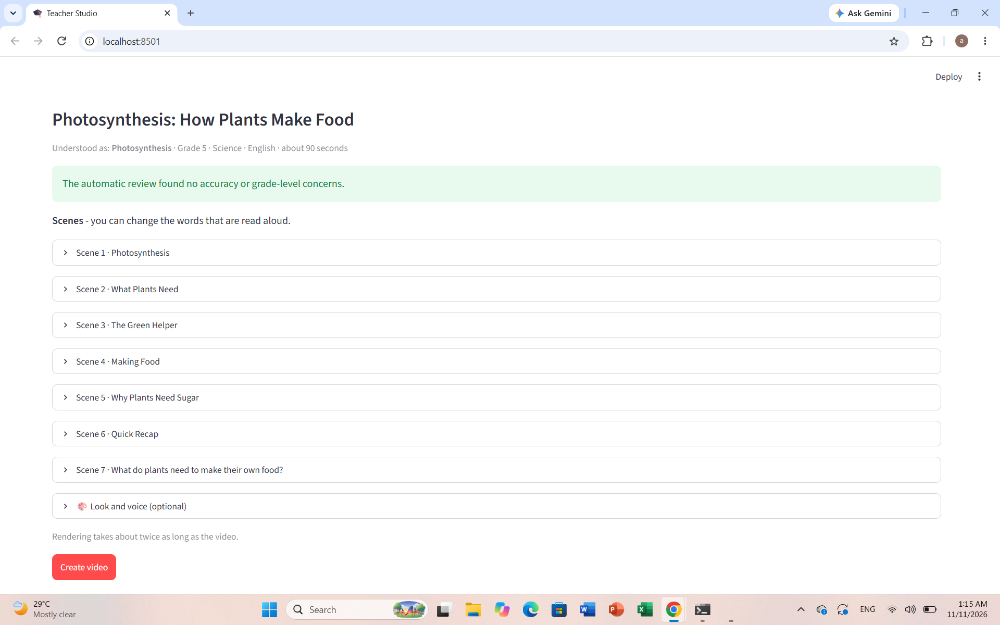
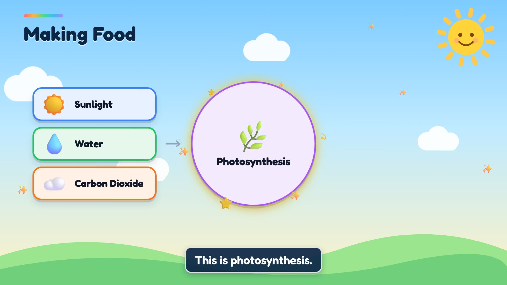
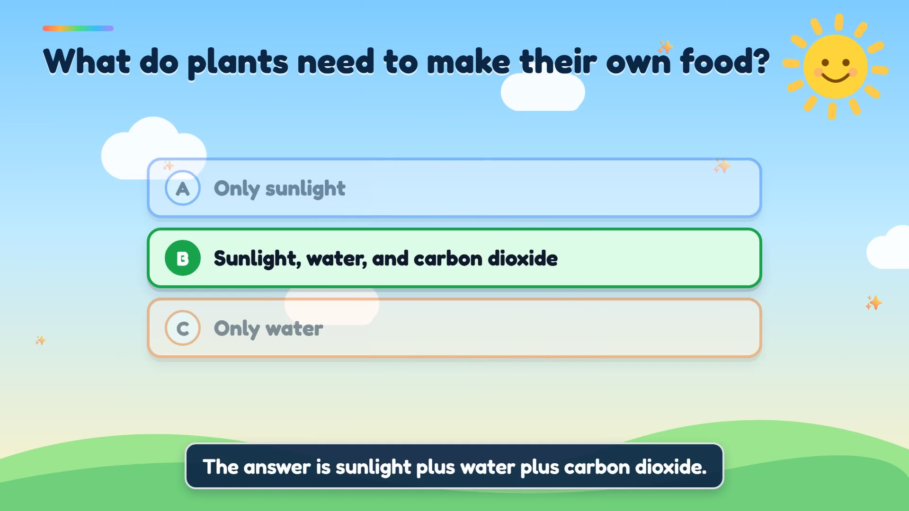

# 🎓 Teacher Studio

**Describe a lesson in one sentence. Get a narrated explainer video with animated visuals.**

> *"Make an explanatory video for Grade 5 about photosynthesis. Start with a question and finish with a quiz."*

Teacher Studio turns that sentence into a ~90-second video: a script written for the grade level, slides and animated diagrams drawn from scratch (no stock footage), natural narration and captions, and a quiz at the end.

It is built on top of the open-source [MoneyPrinterTurbo](https://github.com/harry0703/MoneyPrinterTurbo) (voice, captions and video pipeline), with Claude planning each lesson.

| 1. One prompt, a quick question if something is missing | 2. A reviewed lesson plan the teacher can edit |
|---|---|
|  |  |

| 3. Animated diagrams, drawn from the plan | 4. Quiz with the answer revealed on cue |
|---|---|
|  |  |

## How it works

1. **Understand the request.** One small Claude call reads the teacher's text and extracts topic, grade, subject, language, length and any structure they asked for. It asks only about what matters: the grade (if missing) and the length (it suggests one).
2. **Plan the lesson.** Claude fills a small JSON lesson plan (scenes, narration, a layout and items for each slide). The plan is validated with Pydantic; if it is invalid, the model is asked to repair it.
3. **Review.** A second pass flags factual errors and grade-level problems before anything is rendered. The teacher can edit any narration.
4. **Render.** Our renderer draws each scene as HTML, with every element revealed at the moment it is spoken (timed from the audio), captures frames with Playwright, and joins everything with ffmpeg. Narration comes from Edge TTS.

The model never writes HTML or code: it only fills the structured plan, and our renderer draws it. That keeps output reliable, safe (all text is escaped) and cheap in tokens.

Slide layouts: title, flow, cycle, input → process → output, compare, steps, equation, quiz. English and Arabic (right-to-left) are supported. Each lesson's `plan.json` is saved automatically next to its video in `storage/edu/<timestamp>/`.

## Run it

You need Python 3.11+, [ffmpeg](https://ffmpeg.org/) on your PATH, and an Anthropic API key.

```powershell
git clone https://github.com/abushaaa/Teacher-Studio.git
cd Teacher-Studio
python -m venv venv
.\venv\Scripts\Activate.ps1          # Linux/macOS: source venv/bin/activate
pip install -r requirements.txt
pip install playwright
python -m playwright install chromium
copy config.example.toml config.toml
```

Open `config.toml` and set:

```toml
llm_provider = "anthropic"
anthropic_api_key = "sk-ant-..."
anthropic_model_name = "claude-sonnet-5"
```

(`config.toml` is git-ignored, so your key stays on your machine.) Then start the app:

```powershell
streamlit run webui/pages/1_Teacher_Studio.py
```

Command-line version:

```powershell
python -m app.services.edu.pipeline --topic "photosynthesis" --grade "Grade 5" --subject Science --seconds 90 --out output/demo
```

Run the tests:

```powershell
python -m pytest test/edu
```

## Where the code is

| Path | What it does |
|---|---|
| `app/services/edu/intake.py` | Reads the teacher's free text; finds what is missing |
| `app/services/edu/planner.py` | Lesson-plan prompt, validation and repair loop, reviewer |
| `app/services/edu/schema.py` | Pydantic models for requests, scenes and visuals |
| `app/services/edu/renderer.py` | Deterministic HTML/animation renderer and frame capture |
| `app/services/edu/pipeline.py` | Voice, timing, rendering, ffmpeg assembly, CLI |
| `webui/pages/1_Teacher_Studio.py` | The Streamlit page |
| `docs/EDU.md` | Design notes |

## Limitations

- English and Arabic only. The Arabic output has had less testing than English.
- Voices use Edge TTS, which needs an internet connection.
- The automatic reviewer is a helper, not a guarantee: a teacher should still check the content.
- Rendering takes roughly twice as long as the video.

## Credits

Built on [MoneyPrinterTurbo](https://github.com/harry0703/MoneyPrinterTurbo) by harry0703, used under its MIT license. Fonts: Fredoka and Baloo Bhaijaan 2 (SIL Open Font License). Lesson planning by Claude (Anthropic).

By [Ammar](https://github.com/abushaaa).
